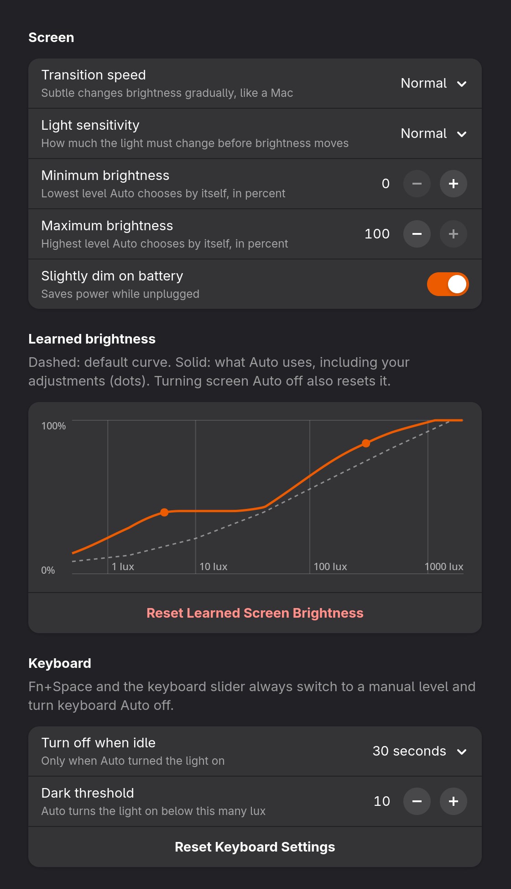

# Lux Capacitor

**Automatic screen and keyboard brightness for Framework laptops running Ubuntu or Fedora with GNOME Shell 50 or 51.** Great lux, no flux.

I built this for my **Framework Laptop 13 (AMD Ryzen AI 300 Series)** and tested it on Ubuntu and Fedora. It handles the Framework keyboard backlight and gets the ambient-light sensor working again after suspend. I haven't tested other Framework models yet. This is my community project, not an official Framework product.

Lux Capacitor adjusts brightness to ambient light, adds separate screen and keyboard Auto controls to Quick Settings, and restores sensor readings after suspend on supported Framework laptops. This is a GNOME Shell extension with an optional system resume hook, not a standalone application for every Linux desktop.

**GNOME's built-in Automatic Brightness must stay off while Lux Capacitor is enabled.** The extension turns it off automatically and keeps it off to prevent two controllers from competing. Use the extension's screen Auto switch instead. Disabling the extension restores the previous native setting; if it was already off, it stays off. Turning only the extension's screen Auto switch off does not hand control back to native automatic brightness.

## Compatibility

| System | Validation |
| --- | --- |
| Framework Laptop 13 (AMD Ryzen AI 300 Series), Fedora Workstation 45, GNOME Shell 51 | v0.2.5: I recorded the Keyboard tile, the keyboard slider, Fn+Space and keyboard Auto on my laptop. v0.2.4: I checked screen Auto and learning, the brightness keys, volume, Quick Settings, lock, suspend and resume, and the settings window. The automated checks pass on Fedora 45. |
| Framework Laptop 13 (AMD Ryzen AI 300 Series), Fedora Workstation 44, GNOME Shell 50 | v0.2.1: I recorded keyboard Auto and Fn+Space on my laptop and confirmed them. Earlier versions: screen brightness, keyboard controls, and recovery after suspend. |
| Framework Laptop 13 (AMD Ryzen AI 300 Series), Ubuntu 26.04.1, GNOME Shell 50 | I used it on my laptop up to v0.1.2. I haven't tested v0.2.x on Ubuntu hardware yet; the automated checks pass. |
| Other Framework models | I haven't tested these yet. They need compatible light-sensor and keyboard-backlight interfaces. |
| GNOME versions other than 50 and 51, or KDE, Xfce, Cinnamon | Not supported by this release. |
| Other laptops with GNOME 50 or 51 | Not hardware-tested. Screen control needs an ambient-light sensor supported by iio-sensor-proxy. Keyboard behavior targets Framework's `chromeos::kbd_backlight` interface. |

I installed this repeatedly on the same Framework laptop while switching between Ubuntu and Fedora, and checked the hardware behavior myself. The automated Ubuntu and Fedora checks test the software, not the physical sensor or suspend. See [TESTING.md](TESTING.md) for what I've checked and what still needs testing.

## Features

- Smooth screen brightness changes and learned manual preferences at observed light levels. Learned preferences never make the screen dimmer as the room gets brighter, and a newer choice replaces a nearby one that contradicts it.
- Small light-sensor fluctuations are ignored, so the screen only moves when the light really changes.
- Learned preferences persist across logins and reboots. Turning screen Auto off resets them to the default curve.
- Separate screen and keyboard Auto controls.
- A settings window (Extensions app → Lux Capacitor → Settings) with transition speed, light sensitivity, minimum and maximum Auto brightness, slight dimming on battery, a graph of the learned brightness curve, and a reset button.
- Keyboard settings: turn the light off after a chosen idle time (only when Auto turned it on), and the light level below which keyboard Auto lights the keyboard. Fn+Space and the keyboard slider still switch to a manual level and turn keyboard Auto off.
- Fn+Space steps through 0%, 20%, 50%, 75%, and 100%, and turns keyboard Auto off. The laptop's firmware handles Fn+Space itself with its own levels, so its level can flash for a moment (under about 75 ms) before Lux Capacitor sets the step.
- Numeric brightness and volume displays, with brightness and volume OSD bars updating immediately as the Quick Settings sliders move; volume keys use steps of 5.
- Desktop idle dimming preserves keyboard Auto.
- Resume recovery reinitializes the Framework `i2c-FRMW0005:*` sensor and restarts iio-sensor-proxy. On other hardware the hook only restarts the sensor service.

## Quick Settings controls

These screenshots are from my Framework laptop on Ubuntu. Click the arrow beside the screen brightness slider to show screen Auto Brightness, or the arrow beside the Keyboard tile to show keyboard Auto Brightness and its slider. Each Auto switch works independently.

<p>
  
  
</p>

Keyboard Auto can leave the backlight at 0% when the room is bright enough. The screenshots show the controls; the keyboard percentage reflects the current backlight level.

## Settings

Open Extensions, then Lux Capacitor → Settings, or run `gnome-extensions prefs lux-capacitor@extensions`. This screenshot uses two example adjustments in the graph.

<p>
  
</p>

### Screen

| Setting | What it does | Default |
| --- | --- | --- |
| Transition speed | How quickly the screen follows a change in light. Brightening is always quicker than dimming. **Normal** settles in about 2 s when brightening and about 7 s when dimming; **Subtle** takes twice as long (about 4 s and 15 s), the closest to a Mac; **Fast** takes half as long (about 1 s and 4 s). Affects the screen only. | Normal |
| Light sensitivity | How much the light must change before the screen moves, so small sensor fluctuations are ignored: about 30% (**Low**), 15% (**Normal**), or 7% (**High**). Larger changes always react right away. | Normal |
| Minimum brightness | Lower limit for Auto's default curve, in percent. Brightness you set yourself is still used exactly, even below it. Raising it above the maximum moves the maximum up too. | 0% |
| Maximum brightness | Upper limit for Auto's default curve, in percent. Brightness you set yourself is still used exactly, even above it. Lowering it below the minimum moves the minimum down too. | 100% |
| Slightly dim on battery | While unplugged, Auto brightness is reduced to 85%. Brightness you set on battery is learned without that reduction, so plugging in brings back your full level. | Off |
| Learned brightness graph | Light level in lux across (log scale, 1 to 1000+), brightness up. The dashed line is the default curve within your limits, the solid line is what Auto actually uses, and each dot is one of your adjustments. | — |
| Reset Learned Screen Brightness | Forgets all your adjustments and returns to the default curve. Turning screen Auto off in Quick Settings does the same. | — |

To teach screen Auto, keep it on and move the brightness slider or press the brightness keys. Auto remembers that level for the current light, keeps following the light, and never makes the screen dimmer as the room gets brighter.

### Keyboard

| Setting | What it does | Default |
| --- | --- | --- |
| Turn off when idle | When keyboard Auto has the light on and you stop typing and using the mouse for this long (5 s, 10 s, 30 s, 1 min, or 5 min), the light fades out, and it comes back on your next input. It needs keyboard Auto on and never changes a level you set yourself. | Off |
| Dark threshold | Keyboard Auto turns the light on when the room is darker than this many lux, and off again once it is 2.5 times brighter (25 lux by default); the gap prevents flickering. The keyboard brightness curve scales with it. | 10 lux |
| Reset Keyboard Settings | Sets the idle timeout back to Off and the dark threshold back to 10 lux. | — |

Fn+Space steps through 0%, 20%, 50%, 75%, and 100%. Fn+Space, the Quick Settings keyboard slider, and the Keyboard tile all set a manual level and turn keyboard Auto off; turn it back on with the Auto switch in Quick Settings. Clicking the Keyboard tile turns the light off, or back on at the last level you chose (100% until you choose one). The screen and keyboard Auto switches are independent.

The Framework firmware locks the keyboard light off when Fn+Space turns it off from exactly 100%: until the next Fn+Space press it overrides every other change. Lux Capacitor therefore sets 100% as 99%, which looks the same, so the lock doesn't happen. If you press Fn+Space twice very quickly from 75%, the firmware can still reach 100% and lock before Lux Capacitor corrects it; the keyboard then shows as off, and one more Fn+Space press turns it back on.

## Install

Download `Install-Auto-Brightness.run` from the [latest release](https://github.com/iErick17/lux-capacitor/releases/latest), then run it as your normal desktop user:

```sh
bash Install-Auto-Brightness.run --check
bash Install-Auto-Brightness.run
```

The installer checks for GNOME Shell 50 or 51, installs dependencies using apt on Ubuntu or dnf on Fedora, and requests sudo for the system resume hook. Log out and back in afterward. Both Auto controls start enabled on a fresh installation. Existing brightness settings are preserved; the volume step is set to 5.

From a source checkout, run `bash install.sh` instead.

The extension ZIP can also be installed with `gnome-extensions install --force <file>.shell-extension.zip`, followed by logout/login and `gnome-extensions enable lux-capacitor@extensions`. This installs the extension only: it does not install dependencies, set the volume step, or install the system resume hook.

Since 0.2.2 the extension ID is `lux-capacitor@extensions`. The installer removes copies installed under earlier IDs (after backing them up) so two brightness controllers never run at once, and your settings carry over. If you install the ZIP by hand instead, uninstall the previous version first.

## Disable and remove

Disable using GNOME Extensions, or run:

```sh
gnome-extensions disable lux-capacitor@extensions
```

The system resume hook remains installed. To remove it, if you installed it through this project:

```sh
sudo rm /usr/lib/systemd/system-sleep/90-restart-iio-sensor-proxy
```

Remove the extension through GNOME Extensions or `gnome-extensions uninstall lux-capacitor@extensions`. Disable it first. Installation backups of the previous extension and settings are stored under `~/.local/state/adaptive-brightness/`. Disabling does not restore the volume step; its previous value is in the backup's `desktop-settings.json`.

## Development

Install GJS, Python 3, and GLib tools, then run:

```sh
bash tests/run.sh
python3 build.py
bash dist/Install-Auto-Brightness.run --check
python3 tests/test-install.py "$PWD/dist/Install-Auto-Brightness.run"
```

Tests mock keyboard and Quick Settings objects; they do not write hardware brightness or install the extension. The install test runs the installer in a private settings session with package installation and root actions mocked. The build produces a standalone installer, an extension ZIP, and checksums in `dist/`.

## License

Copyright 2026 the Lux Capacitor contributors. Distributed under GPL-3.0-or-later. You may use, modify, and redistribute it under those terms. See [LICENSE](LICENSE).

