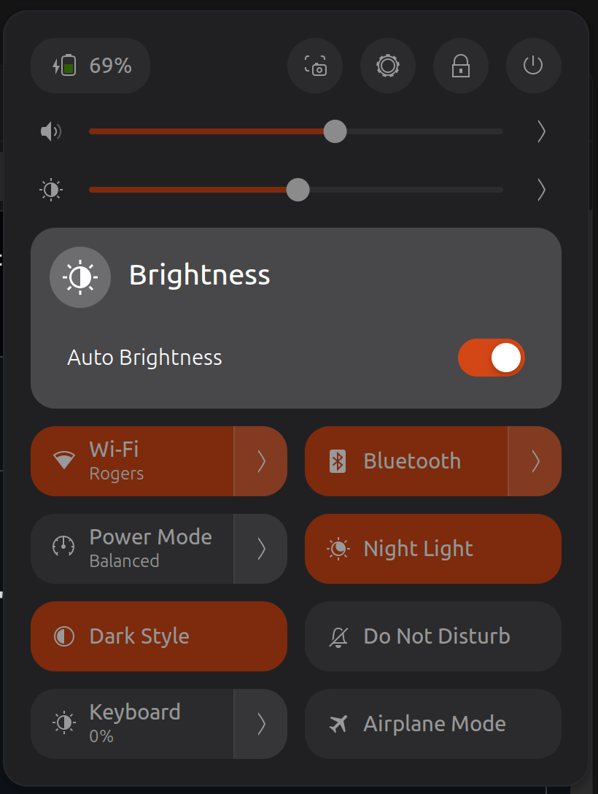
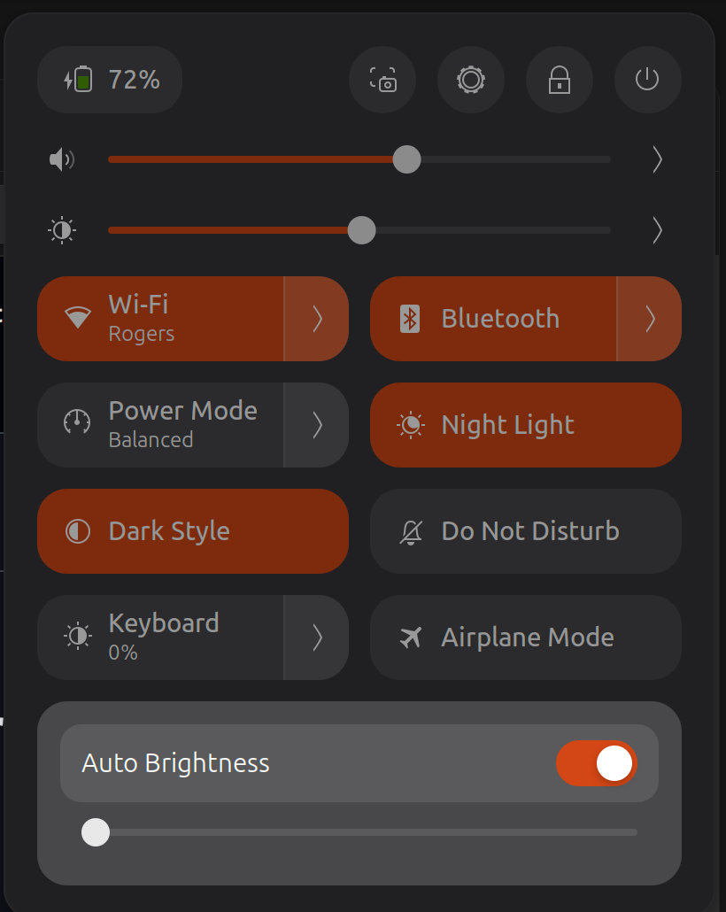

# Lux Capacitor

**Automatic screen and keyboard brightness for Framework laptops running Ubuntu or Fedora with GNOME Shell 50.** Great lux, no flux.

I built this for my **Framework Laptop 13 (AMD Ryzen AI 300 Series)** and tested it on Ubuntu and Fedora. It handles the Framework keyboard backlight and gets the ambient-light sensor working again after suspend. I haven't tested other Framework models yet. This is my community project, not an official Framework product.

Lux Capacitor adjusts brightness to ambient light, adds separate screen and keyboard Auto controls to Quick Settings, and restores sensor readings after suspend on supported Framework laptops. This is a GNOME Shell extension with an optional system resume hook, not a standalone application for every Linux desktop.

**GNOME's built-in Automatic Brightness must stay off while Lux Capacitor is enabled.** The extension turns it off automatically and keeps it off to prevent two controllers from competing. Use the extension's screen Auto switch instead. Disabling the extension restores the previous native setting; if it was already off, it stays off. Turning only the extension's screen Auto switch off does not hand control back to native automatic brightness.

## Compatibility

| System | Validation |
| --- | --- |
| Framework Laptop 13 (AMD Ryzen AI 300 Series), Ubuntu 26.04.1, GNOME Shell 50 | I use it on my laptop. The automated regression checks also pass. |
| Framework laptop, Fedora Workstation 44 | I installed it and confirmed screen brightness, keyboard controls, and recovery after suspend. |
| Other Framework models | I haven't tested these yet. They need compatible light-sensor and keyboard-backlight interfaces. |
| Other GNOME versions or KDE, Xfce, Cinnamon | Not supported by this release. |
| Other laptops with GNOME 50 | Not hardware-tested. Screen control needs an ambient-light sensor supported by iio-sensor-proxy. Keyboard behavior targets Framework's `chromeos::kbd_backlight` interface. |

I checked the Fedora hardware behavior myself. The automated Ubuntu and Fedora checks test the software, not the physical sensor or suspend. See [TESTING.md](TESTING.md) for what I've checked and what still needs testing.

## Features

- Smooth screen brightness changes and learned manual preferences at observed light levels.
- Separate screen and keyboard Auto controls.
- Manual keyboard presets: 0%, 20%, 50%, 75%, 100%.
- Numeric brightness and volume displays; volume keys use steps of 5.
- Desktop idle dimming preserves keyboard Auto.
- Resume recovery reinitializes the Framework `i2c-FRMW0005:*` sensor and restarts iio-sensor-proxy. On other hardware the hook only restarts the sensor service.

## Quick Settings controls

These screenshots are from my Framework laptop on Ubuntu. Click the arrow beside the screen brightness slider to show screen Auto Brightness, or the arrow beside the Keyboard tile to show keyboard Auto Brightness and its slider. Each Auto switch works independently.

<p>
  
  
</p>

Keyboard Auto can leave the backlight at 0% when the room is bright enough. The screenshots show the controls; the keyboard percentage reflects the current backlight level.

## Install

Download `Install-Auto-Brightness.run` from the GitHub release, then run it as your normal desktop user:

```sh
bash Install-Auto-Brightness.run --check
bash Install-Auto-Brightness.run
```

The installer checks GNOME Shell 50, installs dependencies using apt on Ubuntu or dnf on Fedora, and requests sudo for the system resume hook. Log out and back in afterward. Both Auto controls start enabled on a fresh installation. Existing brightness settings are preserved; the volume step is set to 5.

From a source checkout, run `bash install.sh` instead.

The extension ZIP can also be installed with `gnome-extensions install --force <file>.shell-extension.zip`, followed by logout/login and `gnome-extensions enable adaptive-brightness-v2@codex.local`. This installs the extension only: it does not install dependencies, set the volume step, or install the system resume hook.

The existing extension UUID is retained so installation updates the original Auto Brightness extension rather than loading two brightness controllers.

## Disable and remove

Disable using GNOME Extensions, or run:

```sh
gnome-extensions disable adaptive-brightness-v2@codex.local
```

The system resume hook remains installed. To remove it, if you installed it through this project:

```sh
sudo rm /usr/lib/systemd/system-sleep/90-restart-iio-sensor-proxy
```

Remove the extension through GNOME Extensions or `gnome-extensions uninstall adaptive-brightness-v2@codex.local`. Disable it first. Installation backups of the previous extension and settings are stored under `~/.local/state/adaptive-brightness/`. Disabling does not restore the volume step; its previous value is in the backup's `desktop-settings.json`.

## Development

Install GJS, Python 3, and GLib tools, then run:

```sh
bash tests/run.sh
python3 build.py
bash dist/Install-Auto-Brightness.run --check
```

Tests mock keyboard and Quick Settings objects; they do not write hardware brightness or install the extension. The build produces a standalone installer, an extension ZIP, and checksums in `dist/`.

## License

Copyright 2026 the Lux Capacitor contributors. Distributed under GPL-3.0-or-later. You may use, modify, and redistribute it under those terms. See [LICENSE](LICENSE).

